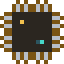

  

  
<b>Hi, I'm maf1nek</b> 

  
    
  
  
  
  

 

I make games in Unreal Engine 5 and build hardware with ESP32 and Arduino.

 **2 games in UE5**: one released on itch.io, one in development 
 **ESP32 and Arduino builds**, from wiring and soldering to firmware 
 **Fusion 360** models and laser-engraved parts 
 Learning **C++** and computer science along the way

 

  
  
  
  
   
  
  
  
  

  <code>C++</code> <code>Python</code> <code>JavaScript</code> <code>Blueprints</code> <code>Post-process</code> <code>Packaged builds</code> <code>Git LFS</code> <code>ESP32-WROOM-32</code> <code>Arduino IDE</code> <code>USB serial</code> <code>Fusion 360</code> <code>Laser engraving</code> <code>Apple Home</code>

 **Games**

 **Sinister Trials** · `UE5` `Blueprints` 
A game I made in Unreal Engine 5 and published on itch.io. [Play it on itch.io](https://monlly.itch.io/sinister-trials)

 **From The Backrooms** · `UE5` `Post-process` `Git LFS` 
A liminal-space horror game, in development. I work on the levels, the lighting and post-process look, and the packaged Windows builds. The project's 1.8 GB of assets are versioned with Git LFS.

 **UE environments**

<table>
  <tr>
    <td width="50%" valign="top"> <b>Tunnel</b> brick, pipes and warm practical lights</td>
    <td width="50%" valign="top"> <b>Yellow rooms</b> Backrooms-style level under fluorescent lights</td>
  </tr>
</table>

 **Hardware in action**

<table>
  <tr>
    <td width="96" align="center"></td>
    <td>
      <b>Kierownica GT</b> 
      ESP32-WROOM-32 · Arduino · Python
      <ul>
        <li>A sim-racing wheel with 12 buttons, read with internal pull-ups and debounced in firmware</li>
        <li>Every press and release goes over USB serial, plus a full state snapshot every second</li>
        <li>Answers <code>PING</code>, <code>STATE?</code> and <code>INFO</code>, so the PC app finds the wheel by itself</li>
        <li>A Python bridge turns it into a gamepad on Windows, started from a single <code>.bat</code> file</li>
      </ul>
    </td>
  </tr>
  <tr>
    <td width="96" align="center"></td>
    <td>
      <a href="https://github.com/maf1nek-code/Smart-Blinds-for-Smart-Home-"><b>Smart Blinds</b></a> 
      ESP32 · Arduino IDE · Apple Home
      <ul>
        <li>The ESP32 shows up in Apple Home as a blinds accessory</li>
        <li>Blinds open and close from the Home app, Siri or automations</li>
        <li>Tested on iOS</li>
      </ul>
      <a href="https://github.com/maf1nek-code/Smart-Blinds-for-Smart-Home-">View the code</a>
    </td>
  </tr>
</table>

 **Work with me**

I'm looking for projects where I can get real experience, contribute to existing work and help fix and improve systems, in games or hardware. Most of my projects are private, so ask if you'd like to see more.

Discord: `monlly.`

  

