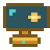
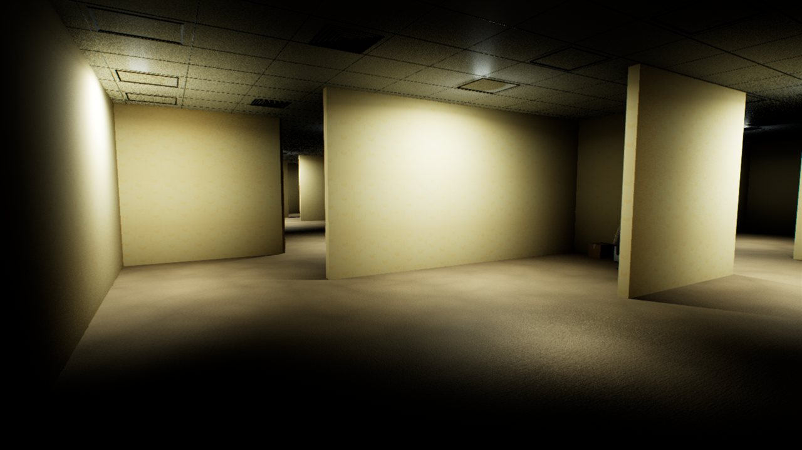
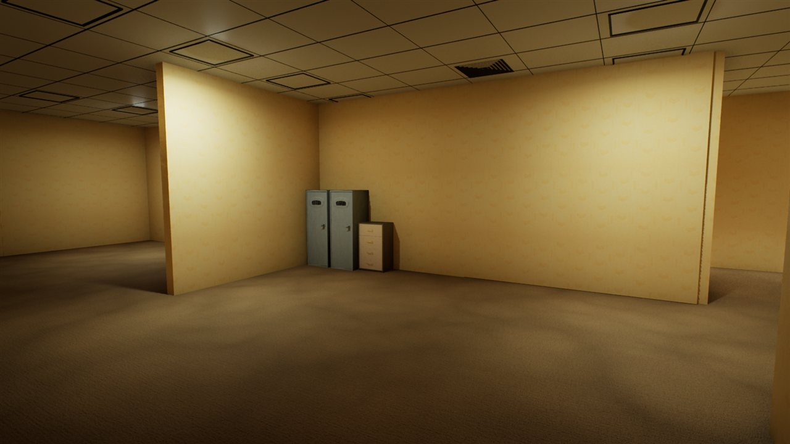
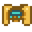
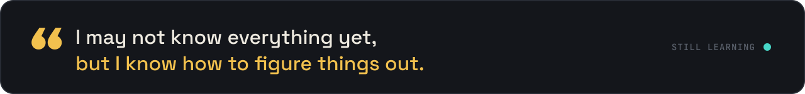

  

  
<b>Hi, I'm maf1nek</b> 

  
    
  
  
  
  

 

I make games in Unreal Engine 5 and build hardware with ESP32 and Arduino.

 **2 games in UE5**: one released on itch.io, one in development 
 **ESP32 and Arduino builds**, from wiring and soldering to firmware 
 **Sim-racing gear**: wheels, a quick release and telemetry LEDs for my rig 
 **Fusion 360** models, 3D prints and laser-engraved parts 
 **Apps and tools**, from an Android TV launcher to build tooling for my game 
 Learning **C++** and computer science along the way

 

  
  
  
  
   
  
  
  
  

  <code>C++</code> <code>Python</code> <code>JavaScript</code> <code>Blueprints</code> <code>Post-process</code> <code>Packaged builds</code> <code>Git LFS</code> <code>ESP32-WROOM-32</code> <code>Arduino IDE</code> <code>USB serial</code> <code>Fusion 360</code> <code>3D printing</code> <code>Laser engraving</code> <code>Apple Home</code> <code>Kotlin</code> <code>Android TV</code> <code>RP2040</code> <code>KiCad</code> <code>GitHub Actions</code>

 **Games**

 **Sinister Trials** · `UE5` `Blueprints` 
A game I made in Unreal Engine 5 and published on itch.io. [Play it on itch.io](https://monlly.itch.io/sinister-trials)

 **From The Backrooms** · `UE5` `Post-process` `Git LFS` 
A liminal-space horror game, in development. It opens with a cinematic prologue in a family house on a rainy night, then wakes you up in Level 0. I work on the levels, the story flow and cutscenes, the lighting and VHS-style post-process, the menus and settings, and the packaged Windows builds. The project's assets are versioned with Git LFS.

 **UE environments**

<table>
  <tr>
    <td width="50%" valign="top"> <b>Tunnel</b> brick, pipes and warm practical lights</td>
    <td width="50%" valign="top"> <b>Yellow rooms</b> Backrooms-style level under fluorescent lights</td>
  </tr>
  <tr>
    <td width="50%" valign="top"> <b>Level 0</b> where the story wakes you up, lit only in patches</td>
    <td width="50%" valign="top"> <b>Office corner</b> props that hint someone was here before you</td>
  </tr>
</table>

 **Hardware in action**

<table>
  <tr>
    <td width="96" align="center"></td>
    <td>
      <a href="https://github.com/maf1nek-code/GT-Wheel"><b>GT Wheel</b></a> 
      ESP32-WROOM-32 · Arduino · Python · JavaScript
      <ul>
        <li>A sim-racing wheel with 12 buttons, read with internal pull-ups and debounced in firmware</li>
        <li>A Python bridge turns it into a gamepad on Windows; it finds the wheel by itself over USB serial</li>
        <li>A configurator app with a button tester, a live drawing of the wheel and a tray icon with autostart</li>
        <li>An LED strip driven by game telemetry (Assetto Corsa, ACC, Le Mans Ultimate): revs, shift light, pit limiter, flags and spotter</li>
        <li>One-click firmware updates: GitHub Actions builds every release, the app downloads and flashes it</li>
        <li>A 3D-printed case and holder for the LED strip, designed in Fusion 360</li>
      </ul>
      <a href="https://github.com/maf1nek-code/GT-Wheel">View the code</a>
    </td>
  </tr>
  <tr>
    <td width="96" align="center"></td>
    <td>
      <a href="https://github.com/maf1nek-code/Quick-Release"><b>FFBeast Quick Release</b></a> 
      Fusion 360 · Python · 3D printing
      <ul>
        <li>A slide-in quick release for an FFBeast direct-drive wheelbase: a 14° V-wedge with a 35° dovetail</li>
        <li>The wedge removes side, rotational and axial play at once, so print tolerances don't matter</li>
        <li>Fully parametric: a Python script rebuilds the whole assembly in Fusion 360, a second one checks fits and collisions</li>
        <li>Printed in PETG, mounted and working on my rig</li>
      </ul>
      <a href="https://github.com/maf1nek-code/Quick-Release">View the models</a>
    </td>
  </tr>
  <tr>
    <td width="96" align="center"></td>
    <td>
      <b>KS PRO DIY</b> 
      RP2040 · KiCad · Fusion 360 · Python
      <ul>
        <li>A formula-style sim-racing wheel built from scratch: 3D-printed body, custom PCB, USB HID firmware and a PC app</li>
        <li>Comes with telemetry for SimHub, a bill of materials and a full assembly guide</li>
      </ul>
      Private for now.
    </td>
  </tr>
  <tr>
    <td width="96" align="center"></td>
    <td>
      <a href="https://github.com/maf1nek-code/Smart-Blinds-for-Smart-Home-"><b>Smart Blinds</b></a> 
      ESP32 · Arduino IDE · Apple Home
      <ul>
        <li>The ESP32 shows up in Apple Home as a blinds accessory</li>
        <li>Blinds open and close from the Home app, Siri or automations</li>
        <li>Tested on iOS</li>
      </ul>
      <a href="https://github.com/maf1nek-code/Smart-Blinds-for-Smart-Home-">View the code</a>
    </td>
  </tr>
</table>

 **Apps and tools**

<table>
  <tr>
    <td width="96" align="center"></td>
    <td>
      <a href="https://github.com/maf1nek-code/Mibox-Custom-launcher"><b>Lumen</b></a> 
      Kotlin · Android TV · PowerShell
      <ul>
        <li>A custom home screen for the Xiaomi Mi Box S, inspired by tvOS: photo backdrops, a favourites row and an app grid</li>
        <li>Full settings panel, works without root on Android TV 8.1 and 9</li>
        <li>PowerShell scripts install it over ADB, set it as the default launcher and restore the stock one</li>
      </ul>
      <a href="https://github.com/maf1nek-code/Mibox-Custom-launcher">View the code</a>
    </td>
  </tr>
  <tr>
    <td width="96" align="center"></td>
    <td>
      <b>TestGate</b> 
      Python · C++ · Unreal Engine plugin
      <ul>
        <li>Tooling for sending test builds of my game to testers and collecting their reports</li>
      </ul>
      Private.
    </td>
  </tr>
</table>

 **Work with me**

I'm looking for projects where I can get real experience, contribute to existing work and help fix and improve systems, in games or hardware. Most of my projects are private, so ask if you'd like to see more.

Discord: `maf1nek_`

  

