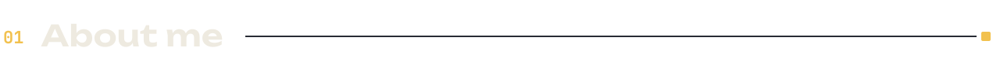
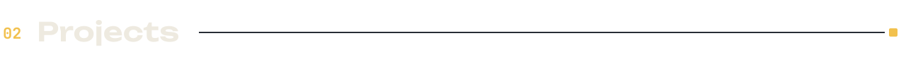
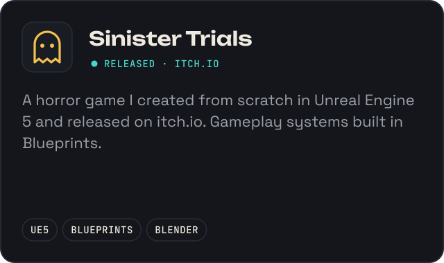
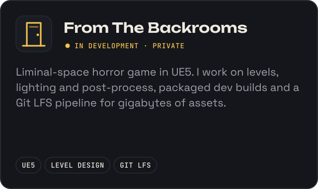
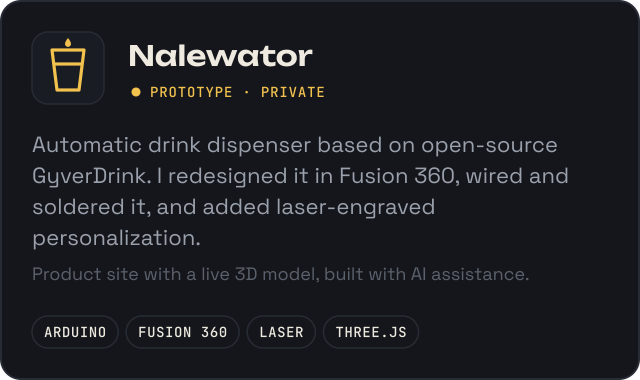
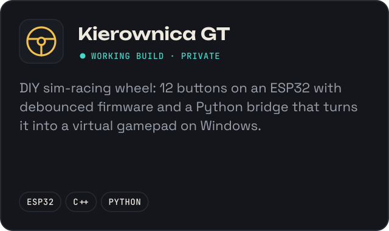
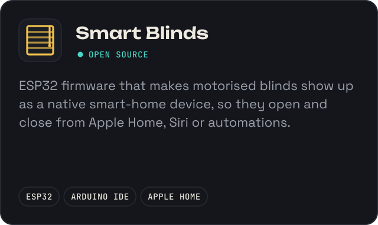
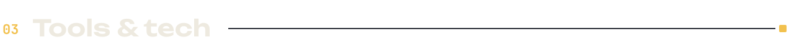
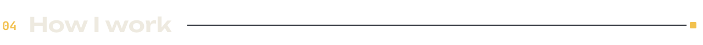

  

  
  

 

I'm **maf1nek**, an **Unreal Engine 5 developer** who also likes building things you can hold in your hand.
On the game side I work on gameplay systems in **Blueprints**, lighting and mood, performance and debugging.
On the hardware side I build **Arduino / ESP32** projects: I design them in **Fusion 360**, solder them, write the firmware and connect them to a PC or the web.

- 🎮 &nbsp;Building **From The Backrooms**, a liminal-space horror game in UE5
- 🔧 &nbsp;Prototyping **Nalewator**, a personalised automatic drink dispenser
- 🏎️ &nbsp;Racing with **Kierownica GT**, a sim wheel I built myself
- 📚 &nbsp;Learning **C++** and computer science, one real project at a time

 

<table>
  <tr>
    <td width="50%">
      
    </td>
    <td width="50%">
      
    </td>
  </tr>
  <tr>
    <td width="50%">
      
    </td>
    <td width="50%">
      
    </td>
  </tr>
  <tr>
    <td colspan="2" align="center">
      
    </td>
  </tr>
</table>

#### 🎨 UE environments
Scenes I put together, with a focus on lighting, mood and performance.

<table>
  <tr valign="middle">
    <td width="50%"></td>
    <td width="50%"></td>
  </tr>
</table>

Private projects are shown without source code. Nalewator builds on the open-source <a href="https://github.com/AlexGyver/GyverDrink">GyverDrink</a> project; the hardware redesign and engraving workflow are mine.

  

  <b>Game dev</b> 
  

  <b>Code</b> 
  

  <b>Hardware &amp; CAD</b> 
  
  
  

  <b>Workflow</b> 
  

 

- **Learning by doing.** I pick a real project and learn whatever it needs, whether that's firmware, CAD or 3D on the web.
- **Fixing before adding.** Making a system stable and fast matters more to me than piling on features.
- **Clean structure and performance**, even in small systems.
- **Honest results.** No fake features, no fake numbers. If something is a prototype, I call it a prototype.

 

I'm looking for projects where I can **gain real experience**, **contribute to existing work** and **help fix and improve systems**, in games or in hardware.

**Discord:** `monlly.` &nbsp;·&nbsp; **itch.io:** [monlly.itch.io](https://monlly.itch.io/sinister-trials)

 

